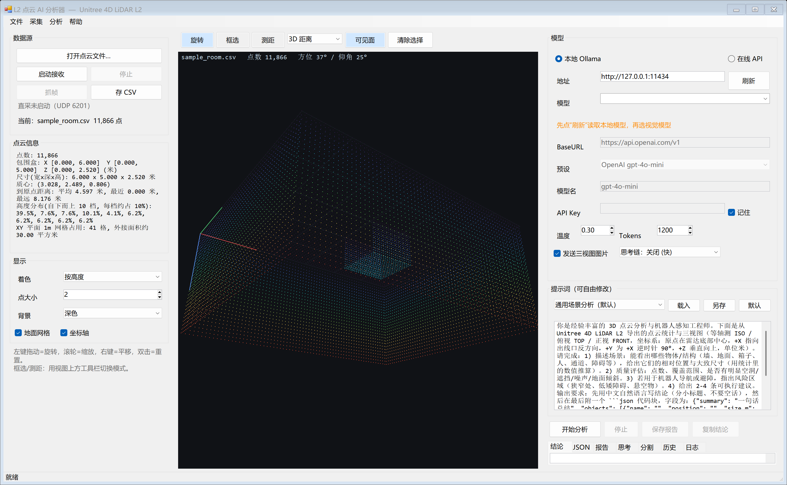

# L2PointAI — 点云 3D 可视化 + AI 分析（Windows 单 exe）

把 `export_l2_xyz.py` 导出的点云（或 L2 实时直采）渲染成三视图，连同客观统计一起发给
**本地 Ollama** 或 **任意 OpenAI 兼容 API**，得到中文结论 + 结构化 JSON + Markdown 报告。

- 语言/框架：C# / WinForms，目标 **.NET Framework 4.8**（Win10 20H2+ / Win11 自带）
- 依赖：**零 NuGet 包**、零第三方 DLL、单文件 exe、不需要管理员权限
- 渲染：CPU z-buffer 软件光栅化（`src/Renderer.cs`），无 GPU/OpenGL 依赖
- 已内嵌：应用图标、Win32 文件版本、DPI 感知清单（`dpiAware=true`）

---

## 1. 直接运行（分发包）

```
dist\L2PointAI.exe            单文件，拷到任意机器双击即可
dist\L2PointAI-1.0.0-portable.zip   便携包：exe + 使用说明 + 示例点云 + SHA256
```

只依赖系统自带的 .NET Framework 4.8（Win10 20H2 以后、Win11 均内置）。
老系统若提示缺少 .NET，装一次官方 4.8 运行库即可。

**学习/试玩**：菜单“文件 → 打开点云…”，选 `sample\示例房间_11k点.csv`。

## 2. 用 Visual Studio 编译

> **VS 2026 请打开 `L2PointAI.sln`（不是 .csproj）。**
> `.csproj` 已改为 SDK 格式，VS 2022/2026 直接支持；旧格式保留为 `L2PointAI.Legacy.csproj`。
> 双击 .csproj「没反应」的原因与排查见 [docs/VS2026-导入指南.md](docs/VS2026-导入指南.md)。

安装 **Visual Studio 2022 / 2026 Community**，只需勾选一个工作负载：

| 安装项 | 是否需要 |
|---|---|
| **“.NET 桌面开发”** | ✅ 必装（含 WinForms 设计器 + C# 编译器 + .NET Framework 4.8 支持） |
| 单个组件里的 **.NET Framework 4.8 targeting pack / SDK** | ✅ 若未随工作负载勾上，手动补 |
| .NET 8/9 SDK、ASP.NET、C++、UWP、MAUI、NuGet 包 | ❌ 都不需要 |

装完双击 `L2PointAI.csproj` → `F5`。目标框架 `net48`、`LangVersion=5`，所以同一份源码
既能用 VS 编，也能用系统自带 `csc.exe` 编。

## 3. 不装 VS 也能编译

```powershell
powershell -ExecutionPolicy Bypass -File .\build.ps1     # -> bin\L2PointAI.exe
powershell -ExecutionPolicy Bypass -File .\package.ps1   # -> dist\ 发布包 + zip + SHA256
```

`build.ps1` 会调用 Windows SDK 的 `rc.exe`（若存在）把 `assets\version.rc` 编成 `version.res`，
一次性嵌入**图标 + 文件版本 + 应用清单**（注意：`csc` 不允许 `win32res` 与 `win32manifest` 同时使用，
所以清单是打进 .res 的）。

## 4. 使用流程

1. 双击 `L2PointAI.exe`
2. **数据**
   - 打开文件：`export_l2_xyz.py --csv scan.csv` / `.ply` / `.txt` 的产物，或 **ROS bag（.bag）**
   - 打开 bag：`文件 → 打开点云…` 选 `.bag` → 选择话题 / 起始帧 / 帧数 → 导入（1 帧 = 一次 360° 扫描）
   - 实时：`采集 → 启动接收`（UDP 6201；电脑网卡 IP `192.168.1.2/24`、关掉 Unilidar 2、放行防火墙）→ `抓帧`
3. **模型**（右上）
   - 本地：`ollama serve` → `ollama pull llava`（或 `qwen2.5vl`、`minicpm-v`）→ 点 **刷新** → 选模型
   - **思考链三档**：`关闭`（think=false，最快，推荐）/ `自动`（不发 think，由服务端决定）/ `开启`（think=true，推理过程显示在「思考」页签，建议 Tokens ≥ 4096）
   - 在线：选预设（OpenAI / DeepSeek / Moonshot / 通义），或自填 BaseURL（含 `/v1`）+ 模型名 + Key
   - Key 用 **Windows DPAPI** 加密保存，仅当前用户可解
4. **提示词**：下拉选模板 → `载入` → 直接改 → `另存` 成新模板（`prompts.json`）
5. **开始分析** → `结论` / `JSON` / `Markdown 报告` / `历史`

每轮自动落盘：`history\<时间戳>\report.md`、`raw.txt`、`meta.json`、`views\{iso,top,front}.png`；思考链开启时另有 `thinking.txt`。

## 5. 数据存放位置

| 场景 | 位置 |
|---|---|
| exe 目录可写（U 盘、桌面、普通文件夹） | 就地：`L2PointAI.settings.json`、`prompts.json`、`history\`、`exports\` |
| exe 在只读目录（Program Files 等） | 自动改用 `%LOCALAPPDATA%\L2PointAI\` |
| 都不想留痕 | 直接删 exe 与该目录即可，不写注册表、不装服务 |

## 6. 界面



## 7. 目录结构

```
L2PointAI\
  L2PointAI.sln            解决方案（VS 2022/2026 打开这个）
  L2PointAI.csproj         SDK 格式工程（net48）
  L2PointAI.Legacy.csproj  旧式工程（仅 VS 2019 及更早）
  NuGet.config             清空包源，离线 restore
  build.ps1                 无 VS 编译（csc.exe + rc.exe）
  package.ps1               生成 dist\ 发布包 / zip / SHA256
  assets\                   app.ico、version.rc、示例点云、生成脚本
  docs\                     界面截图 + VS2026-导入指南.md
  tests\mock_server.ps1      模拟 Ollama/OpenAI 的服务端，用于流式联调
  src\
    Program.cs              入口 + --selftest / --apitest / --uitest / --shot / --capture
    MainForm.cs             WinForms 界面 + 3D 视图控件 + 分析流程
    Renderer.cs             z-buffer 软件渲染、三视图、PNG 导出
    PointCloud.cs           CSV / TXT / ASCII PLY 解析、统计、采样、导出
    LiveCapture.cs          L2 UDP 协议解析 + 持续接收缓冲 + 抓帧
    AiClient.cs             Ollama / OpenAI 兼容流式客户端
    Settings.cs             配置、DPAPI Key、提示词模板、历史记录、数据目录选择
    Json.cs                 极简 JSON 解析/序列化（无依赖）
    AssemblyInfo.cs         版本与产品信息
    app.manifest            DPI 感知 / asInvoker / 兼容性
```

## 8. 自测命令（无需硬件、无需模型）

```powershell
L2PointAI.exe --selftest                        # 合成房间 -> 三视图 + 统计
L2PointAI.exe --selftest D:\scan.csv out\       # 用真实导出文件跑
L2PointAI.exe --uitest                          # 建窗口 1.5 秒后退出
L2PointAI.exe --shot ui.png ollama D:\scan.csv  # 截图整个界面
L2PointAI.exe --capture 5 6201 out.csv          # 命令行直采 5 秒
L2PointAI.exe --bag "D:\record.bag" 1           # 从 bag 取 1 帧（默认第一个 PointCloud2 话题）
L2PointAI.exe --bag "D:\record.bag" 100         # 合并 100 帧
L2PointAI.exe --bagshot "D:\record.bag" dlg.png # 截图导入对话框
L2PointAI.exe --bag ".\assets\test_l2.bag" 2      # 仓库内的合成 bag 夹具（2 帧，78 点）
L2PointAI.exe --seg "D:\record.bag" 0.2 30 81   # 无界面分割测试（体素/最小点数/帧数）
L2PointAI.exe --apitest ollama http://127.0.0.1:11434 llava out.txt
```

## 9. ROS bag 支持说明

| 项 | 说明 |
|---|---|
| 格式 | **ROS1 bag v2.0**（magic `#ROSBAG V2.0`），`sensor_msgs/PointCloud2` 话题 |
| 压缩 | 仅支持未压缩 chunk（`compression=none`）；bz2/lz4 会提示先 `rosbag decompress` |
| ROS2 | 目录式 bag（sqlite3/mcap）不支持，请先转成 ROS1 bag |
| 字段 | 取 `x/y/z`（float32）与 `intensity`（float32/uint16/uint8）；`ring`、`time` 暂不使用 |
| 性能 | 553 MB / 682 chunk 全量扫描约 **0.2 秒**；单帧解析约 4 ms；100 帧合并 408k 点约 26 ms |
| 默认行为 | 只取 1 帧，避免传感器移动造成拖影；需要更密点云再调大帧数（多帧是直接叠加） |
| 话题 | 自动列出包内所有 PointCloud2 话题，默认选第一个（L2 录包通常是 `/unilidar/cloud`） |

## 10. 分割与测距

在 3D 视图上方有一排工具按钮：`旋转 / 框选 / 测距 / 清除选择 / 自动分割 / 导出选中`。

| 功能 | 操作 | 结果 |
|---|---|---|
| **框选分割** | 点「框选」→ 在视图里拖一个矩形 | 选中矩形内的点，其余变暗；「可见面」按钮控制是否只选最前表面（默认开，深度测试） |
| **两点测距** | 点「测距」→ 选下拉 `3D 距离 / 水平距离 / 点到面` → 点两个点（自动吸附 14 px 内最近点） | 视图画连线并标注结果；点到面用首个点 0.4 m 邻域 PCA 拟合平面，输出 |法向距离| 与法向量 |
| **自动分割** | 「分割」页签里设 `体素 m` / `最小点` → 点「运行分割」 | 体素连通分量聚类，列出每簇点数/尺寸/中心/最近距离；点列表项高亮该簇；参数随配置保存 |
| **导出** | 「导出该簇」或「导出选中」 | 存到 `exports\cluster_XX_<时间>.csv` / `selection_<时间>.csv` |

**距离的定义**：都相对于雷达原点（点云坐标系原点 = 底座中心），单位米；点到面用局部 PCA 平面。

**分割结果会写进 AI 提示词**：运行分割后，提示词里自动追加「共 N 个簇」及最大 6 个簇的点数/尺寸/中心/最近距离；框选区域也会一并附上，模型可据此回答“有几个物体、多大、多远”。
**分割效果**：单帧扫描效果好；多帧合并（尤其传感器移动）会让簇彼此连通成一大块，建议先按单帧分割。
实测：429,211 点 → 11 个簇，**29 ms**；4,195 点 → 8 簇，7 ms。
## 11. 自适应缩放（高 DPI / 不同设备）

不同设备（100% / 125% / 150% / 200%、RDP、不同分辨率）缩放比不同，本程序的策略是**一个比例通吃**：

```
ui = min( GDI DPI / 96 ,  工作区能装下设计尺寸的最大比例 )
```

- 字号统一用**像素**单位：`Font(...12f * ui, GraphicsUnit.Pixel)`，与控件尺寸同一把尺子
- 界面只按 96 DPI 设计一次，启动时调用**唯一一次** `Scale(ui)`
- 关闭 `AutoScaleMode`（设为 `None`），避免与 DPI 感知叠加造成“缩放两次”
- 缩放上限由 `屏幕工作区 / (1480×940×1.06)` 决定：2K/4K 屏可放大到 2×，小屏自动收敛，**不会超出屏幕**
- 两侧面板包在 `AutoScroll` 容器里，极端窄窗口下出现滚动条而不是裁切

实测（本机 GDI 192 DPI、工作区 3840×2064）：`ui = 2.0`，窗口 2934×1809，布局无重叠、无截断。

调试命令：

```powershell
L2PointAI.exe --shot ui.png ollama cloud.csv 0 none 1.5   # 额外按 1.5x 放大后截图
L2PointAI.exe --shot ui.png ollama cloud.csv 0 none 1 1100 740   # 指定窗口尺寸
```
## 12. 常见问题

| 现象 | 处理 |
|---|---|
| 直采“绑定失败” | 关掉 Unilidar 2；`netstat -ano \| findstr 6201` 查占用 |
| 收不到点 | 网卡加 `192.168.1.2/24`（**别填网关**）；放行 UDP 6201；雷达需 ENET UDP + 3D 模式 |
| 分析报 401/404 | BaseURL 要带 `/v1`；Key 有效；模型支持图像输入 |
| 模型看不到图 | 换视觉模型，或取消“发送三视图图片”只发统计 |
| `Expect100Continue` 卡死 | 已在客户端关闭；自建服务端若强制 100-continue 需自行处理 |
| 大点云卡顿 | 默认渲染上限 25 万点，可改 `maxViewPoints` |
| **报告里「分析结论」是空的** | 思考型模型把 token 预算全用在 thinking 上（`done_reason=length`）。把「思考链」切到 `关闭`；或切到 `开启` 并把 Tokens 调到 4096 以上。程序在 content 为空且 thinking 非空时会自动回退展示，并把 thinking 存成 `thinking.txt` |
| 模型答复被截断 | Tokens 太小（默认 2048），调大；或减少附图 |

## 14. 杀软误报与代码签名

Windows Defender 对未签名、零信誉的新 exe 容易出现 `Trojan:Win32/Wacatac.B!ml` 之类误报（`!ml` 为机器学习判定）。

- **签名解决的是**：SmartScreen“未知发布者”、企业 AppLocker/WDAC 策略拦截
- **签名不解决**：反病毒启发式误报 → 首选免费误报申诉
- 自签名只在导入根证书的机器有效，对外分发仍显示不受信任

签名脚本（自动找 signtool、SHA256 + 时间戳）：

```powershell
.\sign.ps1 -Pfx .\codesign.pfx -Password 口令     # 购买的 OV/EV 证书
.\sign.ps1 -Thumbprint <指纹>                      # 证书已在存储中
.\sign.ps1 -SelfSigned                             # 内部测试用
```

详细说明（场景选择、成本、申诉步骤、排除项）见 [docs/签名与误报处理.md](docs/签名与误报处理.md)。
## 15. 已修复的关键问题

| 时间 | 问题 | 根因 | 修复 |
|---|---|---|---|
| 2026-11-22 | 分析时弹 `ArgumentOutOfRangeException: chunkLength` | 流式回调在后台线程 `StringBuilder.Append`，UI 线程同时 `ToString()` 更新结论框（`StringBuilder` 非线程安全） | 加 `_streamLock`，写入与快照都在锁内；读取时截断到 40 万字符 |
| 2026-11-22 | 高 DPI 下控件堆叠 | 字体按 DPI 变大而控件尺寸未缩放 | 统一 `ui = min(GDI DPI/96, 工作区可容纳比例)`，字体用像素单位，仅一次 `Scale(ui)` |
| 2026-11-22 | 思考型模型结论为空 | `num_predict` 被 thinking 吃光（`done_reason=length`） | 默认 `think:false`，并可三档切换；空答复自动回退思考内容 |

回归命令：`--streamtest 400 3000`（流式 UI 压力测试）、`--uitest`、`--selftest`。
## 16. 重新打包

```powershell
.\package.ps1            # 生成 dist\L2PointAI.exe、zip、SHA256SUMS.txt
.\package.ps1 -NoZip     # 只要 exe
```

版本号来自 `src\AssemblyInfo.cs` 与 `assets\version.rc` 两处，改版本时请同步。
